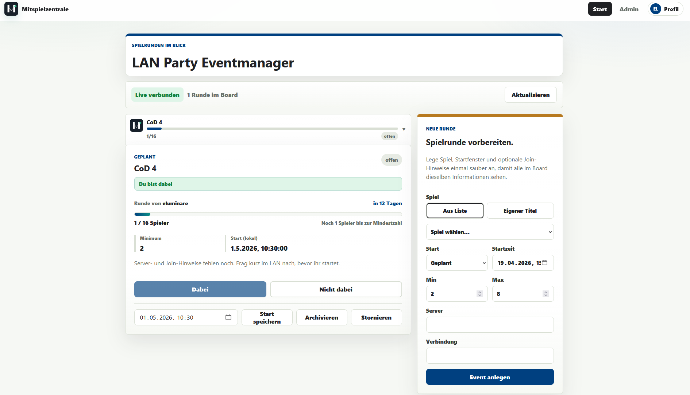
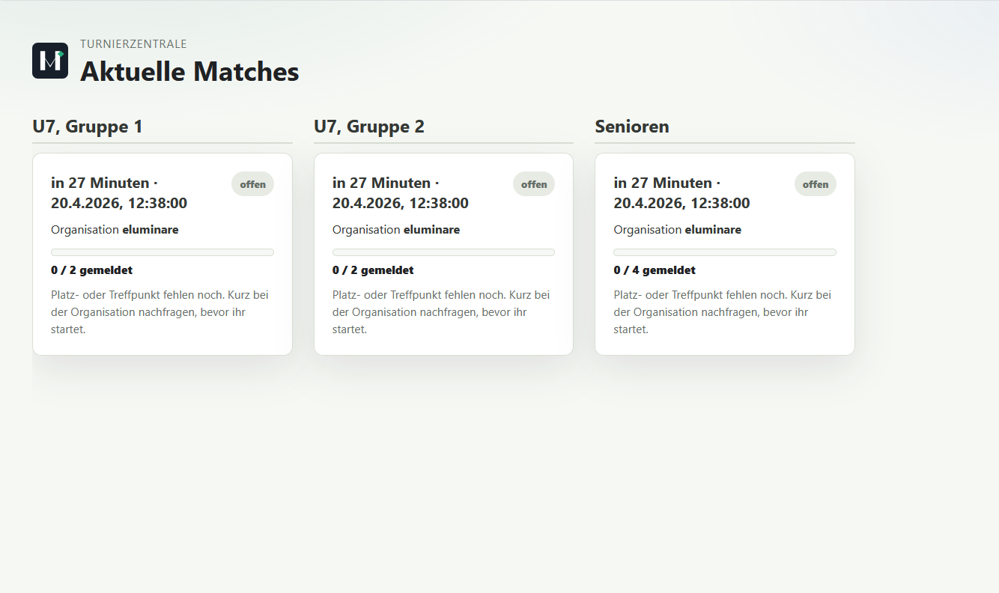

# Hermes / Matchdesk / Mitspielzentrale

Codename Hermes ist eine responsive WebApp für die Organisation von Spielrunden. Gestartet für LAN-Parties, können nun auch Turniere für verschiedene Sportarten darüber verwaltet werden. Die Auswahl findet anhand von Projekttemplates statt. User melden sich mit Username und E-Mail-Einmalcode an, Manager / Organisatoren legen Events an, und Teilnehmer stimmen mit `dabei` oder `nicht dabei` ab.

Build- und Release-Hinweise liegen in [`building.md`](building.md).


## Oberfläche



Die WebApp ist in getrennte Arbeitsbereiche aufgeteilt:

- `#Start`: Eventübersicht für Abstimmung, Status, Startzeit und Serverdaten, sowie Eventverwaltung.
- `#login`: Login vor der Anmeldung; nach dem Login wird daraus `Profil` mit Konto, **API-Tokens** (Integrationen), Logout, Notification-Einstellungen und Geräteverwaltung.
- `#infos`: Falls aktiviert, stehen hier weitere Informationen rund um das Hauptevent bereit
- `#admin`: Userverwaltung, Rollenzuweisung, Invite-Codes, Audit-Log und globale Einstellungen.

Im Adminbereich können Designfarben und Theme unter dem Unterpunkt **Design** gepflegt werden. Diese Werte liegen wie die übrigen App-Einstellungen in `app_settings` und werden beim Laden der WebApp angewendet.

Admins sehen im Bereich `#admin` außerdem ein Audit-Log. Dort werden Login/Logout, User- und Settingsänderungen, Eventaktionen, Teilnahmen sowie Backup/Restore-Aktionen chronologisch angezeigt.

Admins können die öffentliche Registrierung aktivieren und Invite-Codes für LAN-Partys erstellen. Neue User registrieren sich dann mit Invite-Code, Username und E-Mail-Adresse; danach wird der Login-Code per E-Mail verschickt.

Invite-Codes sind dabei **credential-like**: Sie werden von Hermes generiert, sind für Admins sichtbar und sollten wie Zugangsdaten behandelt werden. Audit-Logs enthalten bewusst nur eine maskierte Variante (kein vollständiger Invite-Code in den Metadaten).

## Kiosk Modus
Falls aktiviert, kann über eine entsprechend generierte URL eine Übersicht der anstehenden Spiele angezeigt werden. Die Funktion ist primär für die Darstellung auf Fernsehern und Co. vorgesehen.


## Wo Werden Einstellungen Gespeichert?

Hermes speichert Einstellungen in SQLite in der Tabelle `app_settings`.

Die SQLite-Datei liegt lokal unter:

```text
HERMES_DB_PATH
```

Im Docker-Setup ist das:

```text
/data/hermes.sqlite
```

Mit S3-Backend bleibt SQLite die lokale Arbeitsdatenbank. S3 wird als persistentes Snapshot-Backend verwendet: Beim Start wird die Datenbank aus S3 wiederhergestellt, falls lokal keine Datenbank existiert, und nach Schreiboperationen wird ein Snapshot nach S3 hochgeladen.

Das ist absichtlich kein verteiltes Live-Dateisystem. Hermes ist für eine einzelne laufende Instanz gedacht.

## Wasabi S3

Die Vorgabe ist eingetragen:

```env
HERMES_STORAGE_BACKEND=s3
HERMES_S3_BUCKET=hermes-storage
HERMES_S3_REGION=eu-central-2
HERMES_S3_ENDPOINT=https://s3.eu-central-2.wasabisys.com
HERMES_S3_CREDS_FILE=./s3.creds
HERMES_S3_DB_KEY=hermes.sqlite
HERMES_S3_RESTORE_MODE=if-missing
```

`s3.creds` wird nicht versioniert. Unter Docker wird die Datei readonly nach `/run/secrets/s3.creds` gemountet.

Unterstützte Formate für `s3.creds`:

```env
AWS_ACCESS_KEY_ID=...
AWS_SECRET_ACCESS_KEY=...
```

Alternativ:

```env
access_key=...
secret_key=...
```

Wasabi-Export mit Bindestrich wird ebenfalls erkannt:

```env
access-key=...
secret-key=...
```

Oder zwei Zeilen ohne Schlüsselname:

```text
ACCESS_KEY
SECRET_KEY
```

## Gameserver (CubeCoders AMP)

Optionales Modul: Hermes zeigt zu jedem Event den Status des passenden Gameservers, einen Verbinden-Knopf und – ab Rolle `manager` – Start, Stopp, Neustart, Update und Konsole. Ausgeführt wird alles in [CubeCoders AMP](https://cubecoders.com/AMP); Hermes spricht direkt mit dem AMP-Controller.

### Voraussetzungen

- Ein **AMP-Dienstkonto** (z. B. `hermes`) mit eigener, **minimaler Rolle**: Instanzen sehen, Start/Stop/Restart/Update und Konsole lesen/schreiben auf den Spiele-Instanzen. Nicht die Rolle `*` (Super Admin) verwenden. Ohne 2FA, weil Hermes sich unbeaufsichtigt anmeldet.
- Die **CA-Datei** (PEM), die das Zertifikat des AMP-Controllers ausgestellt hat, falls dieser kein öffentlich vertrauenswürdiges Zertifikat nutzt. TLS wird immer geprüft; es gibt keinen „Zertifikat ignorieren"-Schalter.
- Jedes Spiel muss in AMP **mindestens einmal erfolgreich aktualisiert** worden sein. Ohne erfolgreiches erstes Update (`App.HasSuccessfullyUpdatedAtLeastOnce`) startet AMP das Spiel nicht – und meldet dabei keinen Fehler. Erstes Update daher im AMP-Panel oder über „Mehr … → Update" in Hermes auslösen.

### Umgebung

Zugangsdaten liegen **nur** in der Umgebung, nie in `app_settings` oder Backups:

```env
HERMES_AMP_USERNAME=hermes
HERMES_AMP_PASSWORD=...
# Optional: Datei für das rotierende rememberMe-Token (spart den Passwort-Login nach Neustarts)
HERMES_AMP_REMEMBER_TOKEN_FILE=/data/amp-remember.token
# Optional: CA des AMP-Controllers (leer = System-Trust-Store)
HERMES_AMP_CA_FILE=/run/secrets/amp-ca.pem
```

Unter Docker wird die CA wie `s3.creds` readonly gemountet (siehe `docker-compose.yml`):

```yaml
    environment:
      HERMES_AMP_CA_FILE: /run/secrets/amp-ca.pem
    volumes:
      - ./amp-ca.pem:/run/secrets/amp-ca.pem:ro
```

Danach in Hermes unter **Admin → Betrieb → CubeCoders AMP** das Modul aktivieren, die Basis-URL des Controllers eintragen (z. B. `https://amp-ctl.lanparty.example`) und unter „Server-Bindungen" Spieltitel aus dem Katalog mit AMP-Instanzen verknüpfen (Host, Port, Verbinden-Art). Events mit passendem Spieltitel bekommen die Bindung automatisch.

Passwörter, RCON-Passwörter und Spielserver-Konfiguration bleiben in AMP. Hermes speichert pro Bindung nur Instanz-ID/-Name, Host, Port und Verbinden-Art; Konsolenausgaben mit Passwörtern werden maskiert.

### Rollen

| Aktion | user | organizer | manager | admin |
|---|---|---|---|---|
| Status sehen, Verbinden | ja | ja | ja | ja |
| Start, Stopp, Neustart, Update | – | – | ja | ja |
| Konsole lesen und Befehle senden | – | – | ja | ja |
| Abschießen (Kill), nur nach Bestätigung | – | – | ja | ja |
| Bindungen und AMP-Einstellungen pflegen | – | – | – | ja |

Die Rechte werden serverseitig geprüft; jede Steueraktion landet im Audit-Log und unterliegt einem Rate-Limit.

### Automatik

Beide Schalter sind standardmäßig aus (Admin → Betrieb → CubeCoders AMP):

- **Server automatisch starten, wenn ein Event bereit ist:** Wird ein Event mit gebundenem Server `bereit` (oder läuft es schon) und der Server ist aus, startet Hermes ihn – **höchstens einmal pro Event**. Stoppt ein Manager den Server danach bewusst, bleibt er aus. Läuft der Server schon (auch im AMP-Ruhemodus „Sleeping") oder ist AMP gerade beim Starten/Updaten, passiert nichts. War die AMP-Instanz selbst aus, startet Hermes zuerst die Instanz und – sobald sie erreichbar ist und das Spiel noch steht – das Spiel genau ein zweites Mal (Nachstart, höchstens 10 Minuten nach dem Instanzstart; Audit `amp.auto_start` mit `followUp`).
- **Leerlauf-Stopp nach Minuten (0 = aus):** Hermes stoppt einen Server, wenn kein aktives Event (offen, bereit, läuft) mehr an ihm hängt und er die ganze Zeit über **0 Spieler** hatte. Fehlt die Spielerzahl in AMP, zählt das nicht als leer.
- **Push „Server für <Spiel> läuft":** Sobald der Server eines aktiven Events beitretbar ist (Ready oder Ruhemodus), bekommen alle, die bei diesem Event **dabei** sind und Benachrichtigungen aktiviert haben, genau einen Push. Der Push enthält nur den Spieltitel und den Link zur Übersicht, keine Serveradresse.

Nach einem Neustart von Hermes übernimmt der erste Durchlauf nur den aktuellen Stand: Es gehen keine Pushes raus, und Server bereits bereiter Events werden nicht automatisch gestartet. Die Automatik prüft alle 30 Sekunden; Auto-Start und Auto-Stopp stehen im Audit-Log als `amp.auto_start` bzw. `amp.auto_stop` (ohne Benutzer).

## Lokal Starten

```bash
npm install
cp .env.example .env
npm run db:bootstrap-admin
npm run build
npm start
```

Für produktive Deployments sollten zusätzlich eigene Secrets gesetzt werden (in `.env`):

```env
HERMES_CSRF_SECRET=change-me
# Einmal festlegen und danach stabil halten, sonst werden bekannte Geräte nicht mehr erkannt.
HERMES_DEVICE_KEY_SECRET=change-me
# Optional: Session-Idle-Timeout in Tagen (1-400, Standard 180)
# HERMES_SESSION_TTL_DAYS=180
```

Die App läuft danach auf:

```text
http://localhost:3000
```

Direkte Einstiege:

```text
http://localhost:3000/#events
http://localhost:3000/#login
http://localhost:3000/#manager
http://localhost:3000/#admin
```

## Docker

```bash
cp .env.example .env
docker compose run --rm hermes node dist-server/db/bootstrap-admin.js
docker compose up --build
```

Das Compose-Setup nutzt:

- SQLite unter `/data/hermes.sqlite`
- Docker Volume `hermes-data`
- Wasabi S3 Snapshot `s3://hermes-storage/hermes.sqlite`
- Credentials aus `./s3.creds`

## Mail

Login-Codes werden per SMTP versendet. Für lokale Tests kann `HERMES_MAIL_MODE=console` genutzt werden.

```env
HERMES_MAIL_MODE=smtp
HERMES_MAIL_FROM=Hermes <hermes@example.test>
HERMES_SMTP_HOST=smtp.example.test
HERMES_SMTP_PORT=587
HERMES_SMTP_SECURE=false
HERMES_SMTP_SECURITY=starttls
HERMES_SMTP_USER=
HERMES_SMTP_PASSWORD=
```

Hinweis: Für Port `587` ist normalerweise STARTTLS korrekt (`HERMES_SMTP_SECURITY=starttls`). Für Port `465` ist implizites TLS korrekt (`HERMES_SMTP_SECURITY=tls`). Der Fehler `wrong version number` bedeutet fast immer, dass implizites TLS gegen einen STARTTLS-Port gesprochen wurde.

## Push Notifications

Web Push benötigt VAPID Keys:

```bash
npx web-push generate-vapid-keys
```

Danach in `.env` eintragen:

```env
HERMES_VAPID_SUBJECT=mailto:admin@example.test
HERMES_VAPID_PUBLIC_KEY=
HERMES_VAPID_PRIVATE_KEY=
```

Browser erlauben Push Notifications nur in einem Secure Context. `http://localhost` funktioniert für lokale Tests, normale HTTP-LAN-Adressen wie `http://192.168.x.x` gelten aber nicht als Secure Context. Hermes liefert kein SSL/TLS, keinen Reverse Proxy und kein Zertifikatsmanagement mit.

Hermes setzt bei Push-Benachrichtigungen eine Vibrationssequenz und nutzt `requireInteraction` für neue Runden. Ob das Smartphone vibriert oder einen Ton abspielt, entscheidet trotzdem das Betriebssystem, der Browser und die App-/PWA-Installation. Eigene Benachrichtigungstöne können Web Push Benachrichtigungen auf iOS/Android nicht zuverlässig erzwingen.

## Realtime (SSE)

Hermes nutzt für Live-Updates **Server-Sent Events (SSE)**. Die Verbindung sendet Heartbeats und der Client verbindet sich bei Fehlern automatisch neu. Trotzdem können Reverse-Proxies oder Load-Balancer Idle-Timeouts erzwingen — Hermes fällt dann zusätzlich auf Polling zurück.

## HTTP-API, API-Tokens und Doku

Die JSON-API liegt unter **`/api/*`** (siehe OpenAPI). Typische Ressourcen: Events (`/api/events`), Auth & Profil (`/api/auth/...`), Admin (`/api/admin/...`, nur Rolle **admin**), Push (`/api/push/...`), Realtime (`/api/realtime/events` als SSE).

### Authentifizierung

- **Browser / Web-UI:** Session-Cookie `hermes_session` nach erfolgreichem Login. Die Session läuft nach `HERMES_SESSION_TTL_DAYS` Tagen **ohne Nutzung** ab (Standard 180); jede Nutzung verlängert sie (Cookie wird höchstens einmal täglich neu gesetzt).
- **Geräte:** Ein separates, langlebiges `httpOnly`-Cookie `hermes_device` (plus ein Schlüssel im `localStorage` als Fallback) erkennt den Browser beim nächsten Login wieder. Der Gerätename bleibt dadurch auch nach Logout erhalten. Das Cookie authentifiziert **nicht** – ein Mailcode oder Pairing-Link ist immer nötig. „Dieses Gerät vergessen“ verwirft Gerät und Namen.
- **iPhone/iPad Home-Bildschirm-App:** hat einen eigenen Speicher und übernimmt die Safari-Anmeldung nicht. Im Profil einen Pairing-Link erzeugen, kopieren und in der App unter „Mit Pairing-Link anmelden“ einfügen.
- **Skripte & Integrationen:** persönliches **API-Token** mit Header  
  `Authorization: Bearer <token>`  
  Tokens werden unter **`/#login`** (Profil) erzeugt und widerrufen. Der Klartext wird **nur einmal** beim Anlegen angezeigt und danach nur noch als Hash gespeichert.

Ist der Header `Authorization: Bearer …` gesetzt und der Token **ungültig**, nutzt Hermes **keinen** Cookie-Fallback (explizit nur gültiger Bearer oder Cookie).

### API-Token-Scopes

- **`full`:** dieselben Rechte wie der zugehörige Benutzer (Admin / Manager / Organisator / User), inklusive schreibender Requests.
- **`read_only`:** nur **`GET`**, **`HEAD`** und **`OPTIONS`** auf geschützten Routen. Schreibende Methoden (z. B. `POST`, `PATCH`, `DELETE`) auf Events, Admin und Push liefern **`403`** mit Code `api_token_nur_lesen`.  
  Read-only-Tokens dürfen **keine** neuen API-Tokens anlegen oder widerrufen.

### CSRF (Browser vs. Bearer)

Schreibende Requests aus dem **Browser** mit Cookie-Session benötigen den Header **`x-hermes-csrf`** (Token über `GET /api/auth/csrf`).  
Reine **Bearer**-Clients sind von der CSRF-Pflicht **befreit**.

### OpenAPI und Swagger UI

- **`GET /api/openapi.yaml`** — maschinenlesbare Spezifikation (YAML).
- **`GET /api/docs`** — **Swagger UI** zur interaktiven Erkundung der API (lädt Hilfsressourcen von `unpkg.com`; eigene Content-Security-Policy nur für diese Seite).

In Produktion sollte die API nur über **HTTPS** erreichbar sein; Tokens wie Passwörter behandeln.

Die **Fußzeile** der Web-UI zeigt den Link zum Quellrepository und die **Version** aus der laufenden Instanz (`package.json`). Optional kann `HERMES_SOURCE_REPO_URL` in der `.env` auf ein Fork- oder Intern-Repo zeigen.

## Backup, Restore Und Reset

S3 ist das primäre persistente Snapshot-Backend. Admins können im Adminbereich aktiv ein Backup nach S3 starten oder den aktuellen Datenstand aus dem S3-Snapshot wiederherstellen.

**Single-Writer Warnung:** Hermes nutzt SQLite + S3 Snapshots. Das ist **kein** Live-Locking-Backend. Es sollte immer nur **eine** schreibende Hermes-Instanz laufen, sonst können Snapshots inkonsistent werden.

### Backup prüfen (Admin UI)

Im Adminbereich (`/#admin`) zeigt Hermes im Storage-Bereich:

- letzte erfolgreiche Backup-Zeit
- letzte Backup-Fehlerzeit inkl. Fehlercode + kurzer Hinweis (ohne Secrets)
- nicht-geheime Location-Details (Bucket/Key/Region/Endpoint)

### Restore Safety Modell

Restore ist bewusst **validation-first** und **hard-blocked**:

- Snapshot wird vor dem Überschreiben geprüft (Tabellen, Migrations-Stand, kompatible Spalten, Foreign Keys).
- Wenn die Validierung fehlschlägt, wird **nichts** mutiert (kein “force restore”).
- Vor dem eigentlichen Restore erstellt Hermes ein **Recovery-Snapshot** nach S3.
- Restore läuft all-or-nothing in einer Transaktion.

Recovery Retention: Hermes behält die letzten **10** Recoveries (ältere werden best-effort gelöscht).

### Failed-Restore Recovery (Rollback)

Bei einem erfolgreichen Restore zeigt Hermes die Recovery Info:

- `recovery.id`
- `recovery.key` (z.B. `recoveries/...sqlite`)

Recovery aus S3 herunterladen (Beispiel):

```bash
aws s3 cp "s3://<bucket>/<recovery.key>" ./recovery.sqlite
```

Rollback-Optionen:

1) Recovery-Snapshot als neues Live-Snapshot-Target hochladen (z.B. `HERMES_S3_DB_KEY=hermes.sqlite`):

```bash
aws s3 cp ./recovery.sqlite "s3://<bucket>/<HERMES_S3_DB_KEY>"
```

2) Alternativ temporär `HERMES_S3_DB_KEY` auf den Recovery-Key setzen und Restore erneut ausführen.

Hermes validiert den Snapshot immer vor dem Überschreiben.

Für lokale manuelle Backups kann zusätzlich die SQLite-Datei gesichert werden.

Backup aus Docker Volume:

```bash
docker compose stop
docker run --rm -v hermes_hermes-data:/data -v "$PWD":/backup busybox cp /data/hermes.sqlite /backup/hermes.sqlite.bak
docker compose up -d
```

Reset lokaler Docker-Daten:

```bash
docker compose down -v
```

Wenn `HERMES_S3_RESTORE_MODE=if-missing` gesetzt ist, wird beim nächsten Start wieder aus S3 geladen, sofern dort ein Snapshot existiert.

## Prüfung

```bash
npm test
npm run build
npm audit --omit=dev
```

Der Playwright-Test ist vorbereitet:

```bash
npm run test:e2e
```

Falls Chromium wegen fehlender Systembibliotheken nicht startet, müssen die Playwright OS-Abhängigkeiten auf dem Host installiert werden.

## Release-Checklist (Operator)

- HTTP-API verstanden: bei Bedarf **`/api/docs`** für Operatoren/Integratoren bereitstellen; Tokens nur über vertrauenswürdige Kanäle verteilen
- Reverse Proxy / TLS ist **operator-owned** (Hermes liefert kein TLS, nur HTTP)
- `HERMES_COOKIE_SECURE=true` sobald Hermes hinter HTTPS läuft
- `HERMES_CSRF_SECRET` und `HERMES_DEVICE_KEY_SECRET` gesetzt (Device-Secret danach nicht mehr ändern)
- SMTP konfiguriert (und `HERMES_MAIL_MODE=smtp`), `HERMES_MAIL_FROM` gesetzt
- VAPID Keys generiert und gesetzt (`HERMES_VAPID_*`)
- S3 Snapshot-Storage konfiguriert (`HERMES_STORAGE_BACKEND=s3`, Bucket/Endpoint/Region/Key)
- Credentials-Quelle geklärt (Env oder `HERMES_S3_CREDS_FILE`), `s3.creds` bleibt lokal/Secret
- **Single-Writer**: genau eine schreibende Hermes-Instanz
- Backup-Status im Admin UI geprüft (letztes Success/Failure + Location)
- Restore/Rollback verstanden: Recovery-Key wird bei Restore ausgegeben, Rollback via Recovery-Snapshot möglich
- Falls das Gameserver-Modul genutzt wird: AMP-Dienstkonto mit minimaler Rolle, `HERMES_AMP_USERNAME`/`HERMES_AMP_PASSWORD` gesetzt, CA gemountet (`HERMES_AMP_CA_FILE`), jedes Spiel in AMP einmal erfolgreich aktualisiert
